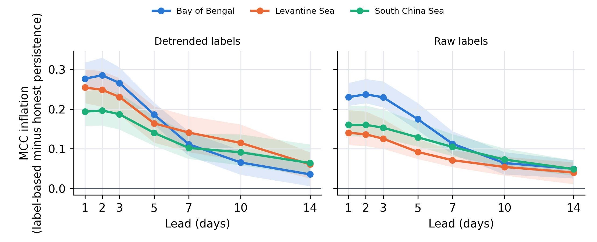
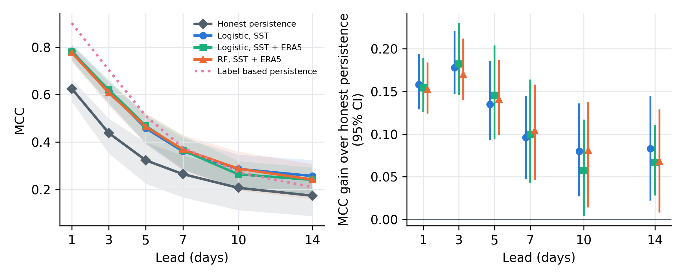

# Evaluation of 1–14-Day Machine-Learning Forecasts of Marine Heatwaves in the Northern Bay of Bengal Against Persistence Benchmarks

Code, processed data and results of my B.S. project (thesis), Department of Meteorology, University of Dhaka (session 2021–22).

**Author:** Abu Baser Mojumder  
**Supervisor:** Sabista Yildiz, Lecturer, Department of Meteorology, University of Dhaka  
**Thesis:** see the [`thesis/`](thesis/) folder

---

## What the study asks

Marine heatwaves (MHWs, Hobday et al. 2016 definition) in the northern Bay of Bengal (15–23°N, 85–93°E) were forecast 1 to 14 days ahead with logistic regression and random forest, using daily NOAA OISST v2.1 SST, ERA5 surface fields and four climate indices for 1982–2025. The main question is how much of the forecast skill is really persistence.

Three persistence benchmarks are compared:

| Benchmark | Rule | Uses future information? |
|---|---|---|
| Label-based persistence | copies the official Hobday label of the forecast day | **yes** – the label of a day depends on the following days |
| Honest persistence | MHW if SST has exceeded the threshold for ≥ 5 days up to the forecast day | no |
| Exceedance persistence | MHW if SST is above the threshold on the forecast day | no |

Models were evaluated with leave-one-year-out cross-validation (purging, 30-day embargo, tuning, calibration and thresholds chosen inside each training fold) and year-block bootstrap confidence intervals, under decision rules fixed before the results were seen.

## Main findings

1. **Label-based persistence inflates skill.** It raises the Matthews correlation coefficient (MCC) of persistence by 0.28 at 1 day and 0.11 at 7 days – about three days of hindsight. The inflation is significant at every lead in the Bay of Bengal, the Levantine Sea and the South China Sea, and larger for single grid cells (median 0.31 at 1 day across 805 cells).
2. **Models beat honest persistence** at every lead (gain 0.13–0.18 MCC at 1–5 days).
3. **At 1–3 days almost all of that gain is SST already being above the threshold.** Against exceedance persistence the models add at most about 0.025 MCC.
4. **Skill beyond exceedance persistence is small** (0.02–0.06 MCC), clearest at about 7 days, and at 10–14 days it depends on the SST product.
5. **ERA5 predictors did not improve forecasts of new events**, and random forest did not beat logistic regression.
6. **With a second SST product (ESA CCI/C3S)** the inflation and the short-lead results are reproduced, but the 10–14-day gain is not; the two products agree on only about half of the MHW days.
7. **Post-hoc analyses:** an L1 (lasso) selection keeps the Indian Ocean basin-wide warming (IOBW) index at 3–14 days but no predictor significantly improves skill over SST alone; GODAS upper-ocean predictors add no skill at 7–14 days.
8. **MHW days are more than twice as frequent after El Niño winters** (Spearman r = 0.40 with the previous-winter ONI); the Indian Ocean Dipole has no effect of its own once ENSO is accounted for.



*Inflation of label-based over honest persistence (MCC difference) by lead, with 95% CIs (thesis Fig. 4.6).*



*Left: MCC by lead for honest persistence, label-based persistence and the models. Right: gain of each model over honest persistence with 95% CIs (detrended labels).*

## Repository contents

```
├── README.md
├── LICENSE                      MIT licence (code)
├── CITATION.cff                 how to cite this repository
├── requirements.txt             Python packages
├── thesis/                      the final thesis (PDF)
├── notebooks/                   the 12 Google Colab notebooks, in run order, with their original outputs
├── data/
│   └── processed/
│       ├── predictor_table_1982_2025.csv   daily regional SST, MHW labels, ERA5 means and climate indices
│       └── godas_box_pentad.csv            GODAS 0–50 m temperature and isothermal-layer depth, box means
└── results/
    ├── tables/                  every result table behind Chapter 4 (CSV)
    └── figures/                 main figures (PNG)
```

## Notebooks

Run in this order. Each notebook starts with a short note on what it does, what it reads and what it writes.

| # | Notebook | What it does | Thesis |
|---|---|---|---|
| 01 | `01_regional_sst_and_mhw_labels` | Regional-mean SST, integrity checks, Hobday MHW detection (raw and detrended) | 3.2, 3.3, 4.1 |
| 02 | `02_era5_indices_predictor_table` | ERA5 daily means, Niño 3.4, DMI, IOBW, RMM; builds the daily predictor table | 3.1, 3.2 |
| 03 | `03_mhw_record_and_onset_composites` | MHW record, onset months, onset composites, spatial coherence | 1.4, 4.1, 4.2 |
| 04 | `04_predictors_and_leakage_checks` | The 83 predictors and a test that none of them uses future data | 3.5 |
| 05 | `05_benchmark_leakage_three_regions` | Benchmark leakage in three regions (RQ1) | 3.4, 3.11, 4.3.1 |
| 06 | `06_evaluation_framework_and_7day_models` | Leave-one-year-out framework; all models at 7 days | 3.6–3.9, 4.6 |
| 07 | `07_skill_by_lead_and_interpretation` | Skill by lead, exceedance persistence, coefficients, drop-one-group test, case studies (RQ2, RQ3) | 4.4–4.8 |
| 08 | `08_grid_cell_leakage_and_cci_download` | Leakage in the 805 grid cells; download of CCI/C3S SST | 3.12, 3.13, 4.3.2 |
| 09 | `09_second_sst_dataset_cci_c3s` | OISST vs CCI/C3S: leakage, persistence and model skill with both products | 3.13, 4.9 |
| 10 | `10_l1_predictor_selection` | L1 logistic regression and half-sample stability selection | 3.10, 4.10 |
| 11 | `11_godas_heat_memory` | Upper-ocean heat memory test with GODAS | 3.14, 4.11 |
| 12 | `12_previous_year_enso_iod` | Previous-year ENSO and IOD vs MHW activity | 3.15, 4.12 |

## Data

| Dataset | Use | Source |
|---|---|---|
| NOAA OISST v2.1, daily, 0.25° | SST, MHW labels, DMI and IOBW indices | NOAA Physical Sciences Laboratory |
| ERA5 hourly single levels | t2m, 10 m wind, surface heat fluxes | Copernicus Climate Change Service (C3S) Climate Data Store |
| Niño 3.4 (ERSST v5) and ONI | ENSO | NOAA Climate Prediction Center |
| RMM1, RMM2 | MJO | Australian Bureau of Meteorology |
| ESA CCI/C3S SST analysis (SST_GLO_SST_L4_REP_OBSERVATIONS_010_024) | second SST product | Copernicus Marine Service |
| NCEP GODAS pentad fields | upper-ocean temperature, isothermal-layer depth | NOAA Climate Prediction Center |

The raw gridded files are not included because of their size (the ERA5 files alone are several GB); the notebooks show how each one was downloaded. The processed files in [`data/processed/`](data/processed/) are enough to re-run notebooks 04–07, 10 and 12. See [`data/README.md`](data/README.md) for the column descriptions.

## How to reproduce

The notebooks were run on Google Colab with the data on Google Drive.

1. Open a notebook in Colab (File → Open notebook → GitHub, or upload the `.ipynb` file).
2. Create this folder layout in your Google Drive:
   ```
   MyDrive/
   ├── Colab Notebooks/
   │   ├── oisst_daily.nc                        OISST files (notebooks 01–02)
   │   └── MHW_Project_Data/
   │       ├── raw/ERA5/temp_u10_v10/            ERA5_t2m_u10_v10_YYYY.nc (notebook 02)
   │       ├── raw/ERA5/Flux/                    ERA5_surface_flux_YYYY.nc (notebook 02)
   │       └── processed/                        all intermediate files and results
   └── MHW/mhw_check/                            outputs of notebook 01, oisst_box_grid.nc (notebook 08)
   ```
3. **Quick start:** copy `data/processed/predictor_table_1982_2025.csv` into `MyDrive/Colab Notebooks/MHW_Project_Data/processed/` and run notebooks 04, 05, 06, 07, 10 and 12 in that order. Notebook 04 creates the feature tables the later notebooks read.
4. Notebook 08 needs a free Copernicus Marine account, and notebook 02 needs a free CDS account for one ERA5 request; put your own credentials where the notebook asks for them.

The long runs (leave-one-year-out with inner cross-validation) take roughly 30–60 minutes per lead on a standard Colab machine; finished leads are saved to Drive and read back if Colab disconnects.

## Results tables

All files are in [`results/tables/`](results/tables/).

| File | Thesis |
|---|---|
| `mhw_events_detrended.csv`, `mhw_events_raw.csv` | MHW event lists (Section 4.1) |
| `wp1_event_stats_3regions.csv` | Table 4.1 |
| `wp1_leakage_curve_bob.csv`, `wp1_leakage_curve_3regions.csv` | Tables 4.2, A.1; Figs. 4.5, 4.6 |
| `wp1c_grid_leakage_summary.csv`, `wp1c_grid_leakage_cells.csv` | Table 4.3; Figs. 4.7, 4.8 |
| `wp2_skill_by_lead_det.csv` | Tables 4.4, 4.6, A.2; Fig. 4.9 |
| `wp2_exceedance_persistence_det.csv`, `rob1_raw_hierarchy.csv` | Tables 4.5, A.3 |
| `p5_results_det.csv` | Table 4.7 |
| `wp5_logit_sst_coefficients.csv` | Fig. 4.10 |
| `wp5_drop_group_det.csv` | Table 4.8 |
| `wp5_case_studies.csv` | Table 4.9 |
| `v2_dataset_comparison.csv`, `v2_diag_period.csv`, `v2_diag_month.csv` | Tables 4.10, 4.11; Fig. 4.12a |
| `v2_leakage_both.csv`, `v2_skill_both.csv` | Tables 4.12, 4.13 |
| `l1_skill_summary.csv`, `l1_skill_with_new_event.csv` | Table 4.14 |
| `l1_halfsample_selection_frequency_by_lead.csv` | Fig. 4.13 |
| `l1_selection_frequency_by_lead.csv` | selection frequency over the LOYO folds (not used for conclusions, see Section 3.10) |
| `wp6_godas_heat_memory.csv` | Tables 4.15, A.4 |
| `wp7_enso_iod_lag.csv`, `wp7_enso_iod_monthly.csv` | Tables 4.16, A.5; Fig. 4.15 |

MCC = Matthews correlation coefficient. "det" = labels detected on detrended SST (main target), "raw" = labels on raw SST. Intervals are 95% year-block bootstrap confidence intervals (2000 resamples).

## How to cite

> Mojumder, A. B. (2026). *Evaluation of 1–14-Day Machine-Learning Forecasts of Marine Heatwaves in the Northern Bay of Bengal Against Persistence Benchmarks*. B.S. project, Department of Meteorology, University of Dhaka.

GitHub also shows a "Cite this repository" button generated from [`CITATION.cff`](CITATION.cff).

## Licence

- **Code** (the notebooks): MIT licence, see [`LICENSE`](LICENSE).
- **Processed data and result tables** (`data/`, `results/tables/`): Creative Commons Attribution 4.0 (CC BY 4.0). They are derived from the datasets listed above; please also acknowledge those sources. ERA5-derived values contain modified Copernicus Climate Change Service information (2026).
- **Thesis text and figures** (`thesis/`, `results/figures/`): © 2026 Abu Baser Mojumder, all rights reserved. They may be read and cited.

## Acknowledgements

NOAA Physical Sciences Laboratory (OISST), the Copernicus Climate Change Service and ECMWF (ERA5), the ESA Climate Change Initiative and the Copernicus Marine Service (CCI/C3S SST), the NOAA Climate Prediction Center (Niño 3.4, ONI, GODAS) and the Australian Bureau of Meteorology (RMM index).
